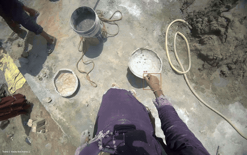
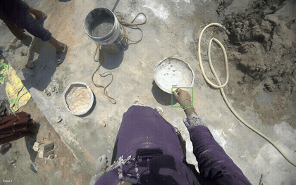

# Detection Quality Adapter

Code and reproduction package for the paper

> **A Post-Processing Adapter for Correcting False Positives and False Negatives in Egocentric Hand Detection**
> Durgesh S. Reddiyar, Independent Researcher. arXiv preprint, 2026 (arXiv:XXXX.XXXXX).
> Dataset: [doi:10.5281/zenodo.23056146](https://doi.org/10.5281/zenodo.23056146)

A stateful, six-stage post-processing layer between a hand detector and its
downstream consumers. It corrects false positives and false negatives in a
stream of per-frame boxes using per-frame geometry and multi-frame tracking,
without retraining or modifying the detector. Every decision is recorded as a
tag on the detection (`reported`, `merged`, `rejected`, `interpolated`), never
as a deletion, so every output is auditable.

<table>
<tr>
<td width="50%">

**Stage 2: tracking.** Raw detections stitched into tracks; each colour is one
track ID, with a fading trail of recent centres.



</td>
<td width="50%">

**Final output: tagged data.** The same clip after the hand pipeline:
green/cyan = kept or interpolated, red/orange/purple = rejected, colour
encodes the reason.



</td>
</tr>
</table>

## Pipeline

| Stage | What it does |
|---|---|
| 1. Geometric | Merges duplicate boxes (IoU + containment), drops implausible size/shape; per frame only |
| 2. Association | Greedy nearest-neighbour tracker on velocity-predicted positions; never uses the detector's left/right label |
| 3. Temporal | Rejects implausible jumps, unsupported flicker, and boxes static in the image while the camera moves (VIO pose) |
| 4. Interpolation | Exit test first (border + outward motion ends the track); otherwise fills short gaps by linear interpolation |
| 5. Selection | Hand-specific. Keeps the two best-supported tracks per frame, not the two most confident boxes |
| 6. Stereo depth | Hand-specific, **opt-in, off by default**. Rejects boxes beyond arm's reach; validated on one clip only (paper Sec. VII-C) |

Stages 1-4 are class-agnostic (`adapter.pipeline.run_pipeline`);
`adapter.hand_config.hand_config()` supplies the hand thresholds and
`adapter.pipeline.run_hand_pipeline` adds Stages 5-6.

```python
from adapter.ingest import load_clip
from adapter.pipeline import run_hand_pipeline

clip = load_clip("data/clip_01")
tracks = run_hand_pipeline(clip.detections, clip.pose)      # Stages 1-5
for t in tracks:
    for d in t.detections:
        print(d.frame, d.xyxy, d.tag.value)
```

## Installation

```bash
conda env create -f environment.yml && conda activate hand-adapter
# or:  python -m venv .venv && source .venv/bin/activate && pip install -r requirements.txt
```

Tested with Python 3.13, numpy 2.5, opencv-python 5.0, pytest 9.1, matplotlib 3.11.

## Data

The 39 clips (85,786 frames, 37 occupations, head-mounted ZED X stereo camera,
1920x1200 at 30 fps) are archived on Zenodo under CC BY 4.0
([doi:10.5281/zenodo.23056146](https://doi.org/10.5281/zenodo.23056146)). They are not stored in git.

```bash
python scripts/download_data.py               # annotations only (~5 MB): tests + all Stage 1-5 results
python scripts/download_data.py --with-video  # + stereo video (~3.9 GB): Stage 6 and visualisations
```

This creates `data/clip_01 ... data/clip_39`, each with `meta.json`,
`frame_ts.json`, `hand_boxes.json` (raw, uncapped, undeduplicated detections),
`vio_pose.json` and, with `--with-video`, `video_left.mp4` / `video_right.mp4`.
The formats are described in `README_DATA.md` inside the archive. The videos are
not face-blurred; see `DATA_LICENSE.md` for the terms of use.

## Reproducing the paper

```bash
pytest      # needs data/ first; 211 passed, 1 xfailed with video (209 + 2 skipped without)
python paper/reproduce_paper.py --data-dir data         # recompute + check 122 paper values (~10 s)
python paper/reproduce_paper.py --data-dir data --rerun-calibration   # also re-run ablation,
                                                        # sensitivity and dropout test (~3 min)
python paper/make_figures.py                            # Figs. 2-4 -> paper/figures/*.pdf
```

`reproduce_paper.py` writes `results/paper_numbers.json` and the CSVs behind the
figures, then prints `PASS`/`FAIL` for every value listed in
`paper/expected_values.json`.

| Paper item | Produced by |
|---|---|
| Table III, Fig. 2 (dataset, boxes per frame) | `paper/reproduce_paper.py` (`dataset_stats`) |
| Table VI (threshold evidence), Sec. VII-A (containment) | `paper/reproduce_paper.py` (`threshold_evidence`), `calibration/sweep_thresholds.py` |
| Fig. 3, Table VII (outcomes, final results) | `paper/reproduce_paper.py` (`final_pipeline`), `calibration/ablation.py` (`classify_clip`) |
| Table VIII, Sec. VIII-D (ablation, sensitivity) | `calibration/ablation.py` -> `calibration/ablation_results.json` |
| Fig. 4, Sec. VIII-E (synthetic-dropout test) | `calibration/dropout_recovery.py` -> `calibration/dropout_recovery_results.json` |
| Table V (edge cases) | `tests/test_hand_config.py` (one test per row; gloved hands is the expected failure) |
| Sec. VII-C (Stage 6 run, ~4 h, needs video) | `python scripts/visualize_hand_pipeline.py --all --stereo-depth` (see `--help`) |
| Fig. 1 | TikZ in `paper/main.tex` |

The paper source (`paper/main.tex`, `paper/references.bib`) builds with
pdfLaTeX + BibTeX. Numbers in Sec. VII-C that come from the stereo analysis
(the vertical offset between the two views, per-occupation working distance)
depend on the nominal stereo calibration and are not re-checked by the script.

## Repository layout

```
adapter/       pipeline stages, configuration (hand_config.py), ingest
calibration/   label-free calibration and evaluation: threshold statistics, ablation and
               sensitivity, synthetic-dropout recovery, track quality; *_results.json outputs
paper/         LaTeX source, bibliography, figures, reproduce_paper.py, expected_values.json
scripts/       download_data.py and visualisation scripts that render annotated video
tests/         synthetic and real-data tests for every stage
```

## Limitations

There is no ground truth: thresholds are evidence-based, not
precision/recall-optimal, and outcome frequencies say how often a rule fires,
not how often it is right. Stage 6 does not generalise beyond its calibration
clip. See paper Sec. IX.

## Citation

```bibtex
@article{reddiyar2026adapter,
  author  = {Durgesh S. Reddiyar},
  title   = {A Post-Processing Adapter for Correcting False Positives and False Negatives in Egocentric Hand Detection},
  journal = {arXiv preprint arXiv:XXXX.XXXXX},
  year    = {2026}
}
```

## License

Code: MIT (`LICENSE`). Data: CC BY 4.0 (`DATA_LICENSE.md`).
